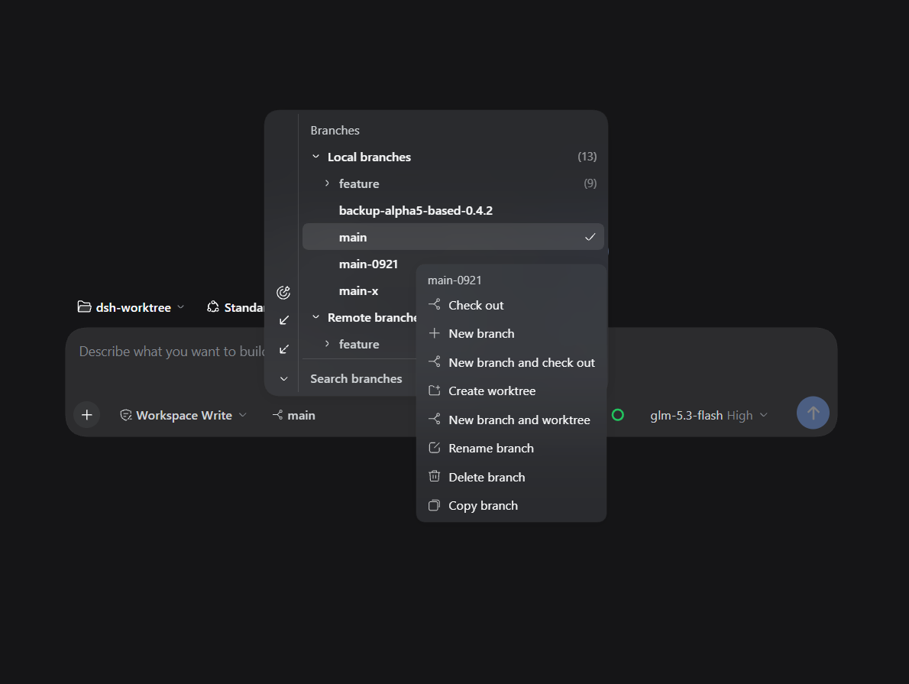

<div align="center">


# dsh-git-worktree

**IDEA-style branch picker, commit graph, non-blocking git actions & worktree isolation for [DeepSeek Harness (dsh)][dsh].**

<p>
  <a href="https://awesome-dsh-plugin.com"></a>
  <a href="https://www.npmjs.com/package/@laoyuehanni/dsh-git-worktree"></a>
  <a href="https://www.npmjs.com/package/@laoyuehanni/dsh-git-worktree"></a>
  <a href="https://github.com/deepseek-ai/deepseek-harness">= 0.2.0-rc.1" height="20" /></a>
  <a href="./LICENSE"></a>
</p>

[简体中文](./README.zh.md) · **English**

[Install](#install) · [Features](#features) · [Worktree Isolation & Manager](#4-worktree-isolation-removal--manager) · [Development](#development)

</div>

<p align="center">
  
</p>

---

## Highlights

| Capability | What you get |
| --- | --- |
| **IDEA-Style Branch Picker** | `/` folder hierarchy, local & remote groups, instant search, locate-current-branch, and colored `↗N` / `↙N` / `↗` / `!` tracking marks. |
| **In-Place Commit Graph** | Expand the popup to browse real commit history & merge graphs across any branch without switching checkouts. |
| **One-Click Worktree Isolation** | Isolate sessions into `<repo>/.dsh/gitworktree/<branch>/` as real DSH workspaces while keeping the main repo's `git status` clean. |
| **Safe Push, Update & Sync** | Compact push review dialog with tag options and explicit `force-with-lease`, fast-forward-only updates, and non-blocking floating progress cards. |
| **Cross-Repo Worktree Manager** | Manage per-repo and legacy central worktrees from **Settings → Plugins**, with uncommitted-file warnings and safe session archival on removal. |

---

## Install

Requires the `web` profile (`dsh web`) and **dsh `0.2.0-rc.1`** or newer.

```sh
dsh plugin --profile web add @laoyuehanni/dsh-git-worktree
```

> [!TIP]
> The package declares `dsh.bundle`, so `add` wires the plugin into the profile's layer stack automatically — no manual config editing needed.

**Update & Remove**

```sh
# Update
dsh plugin --profile web update @laoyuehanni/dsh-git-worktree

# Remove (keeps worktree folders at both storage locations; settings stay in the dsh settings document)
dsh plugin --profile web remove @laoyuehanni/dsh-git-worktree
```

<details>
<summary>Running dsh <code>0.1.2 alpha</code> or upgrading from a legacy <code>github:</code> install (≤ 0.3.2)?</summary>

**For dsh `0.1.2 alpha` hosts**, install the dedicated compatibility dist-tag (currently `0.4.3-dsh-0.1.2-alpha.5`, peers pinned so plain `update` never mixes channels):

```sh
dsh plugin --profile web add @laoyuehanni/dsh-git-worktree@dsh-alpha
```

**Upgrading from a legacy `github:` install (≤ 0.3.2, package name `dsh-git-worktree`)?** GitHub direct installs have ended and an in-place `update` fails to load — remove the old name first, then install from npm:

```sh
dsh plugin --profile web remove dsh-git-worktree
dsh plugin --profile web add @laoyuehanni/dsh-git-worktree
```

Existing worktree folders and plugin settings carry over untouched.

</details>

---

## Features

### 1. IDEA-Style Branch Picker & Commit Graph

- **Hierarchical branch tree**: treats `/` as collapsible folders with last-segment labels and centers the checked-out branch's chain on open. Local and remote branches split into two collapsible groups (a single remote strips its prefix).
- **Search & tracking indicators**: bottom search preserves ancestor folders and highlights hits; toolbar buttons locate the current branch and expand/collapse all. Tracking rows show green `↗N` / blue `↙N` divergence, a bare green `↗` for unpublished branches (only when the repo has a remote), and `!` for missing upstreams.
- **In-place commit graph**: expand the branch popup to browse branches on the left and their real commit history and merge graph on the right without checking anything out. Select a commit for author, date, full message (3-line preview expanding into a scrollable body), and file summary.

<details>
<summary>Details: Commit graph pagination, search & author cache</summary>

- History automatically loads the next page when scrolled to the bottom (a **Load more** button remains available), and search filters loaded titles and hashes.
- The author filter lists every author on the branch and caches that list in memory for the commit; any branch update, fetch, or reload drops the cache.

</details>

---

### 2. Branch Actions & Row Context Menu

- **One-click switching & remote checkout**: pick any local branch for an immediate `git switch` (no confirmation), or pick `origin/feat-x` to check out in place with a tracking branch automatically. Inside a linked worktree, other branches stay listed but dimmed (hinting to act from the main checkout); a started session's menu scopes down to its own branch (fetch and update still work).
- **Row context menu (keyboard: arrow keys + Enter)**: right-click any branch row for **Check out**, **New branch**, **New branch and check out**, **Rename** (local), **Delete** (local, safe `-d` — git refuses unmerged commits or occupied branches), and **Copy branch**; worktree rows offer **Go to this worktree**, **Copy path**, and **Remove worktree**.
- **In-place flyouts**: secondary dialogs (create / rename / confirm) open in place of the menu, validate git ref rules and duplicates as you type, and keep the menu open after in-place actions so you can act on multiple rows in a run (failures keep the flyout open for retry).

---

### 3. Remote Sync, Fast-Forward Update, Push & Live Progress

- **Remote sync**: the last toolbar button fetches every remote and prunes stale tracking branches, refreshing the list in place without a terminal round-trip.
- **Fast-forward branch update**: update the current branch to its upstream from the toolbar or row menu. Divergence, missing upstreams, or conflicting working-tree changes are refused with git's own message — the plugin never stashes or rewrites history on your behalf.
- **Compact branch push**: right-click **Push** on any local or worktree row to preview local commits (independent scroll above a fixed footer) while verifying the remote in the background, without switching checkouts or committing working files. Supports tag options (**All** / **Follow commits**) and **Force push** with an explicit lease (`--force-with-lease`).
- **Floating live progress card**: fetch, update, and push run under a non-blocking IDEA-style floating card showing remote, git stage, count, speed, and a `×` cancel button. Survives switching sessions; long transfers are no longer killed by 20s/120s timeouts (only 5 silent minutes abort them).

<details>
<summary>Details: Push dialog behavior & concurrency rules</summary>

- **Remote & target editing**: the remote selector appears only when multiple remotes exist; target branch editing applies on `Enter` and closes only via `Enter`, `Esc`, or `×` (clicking outside never dismisses it or the push dialog).
- **Failure recovery**: clicking **Push** closes the dialog and continues in the progress card; if push fails, the dialog reopens with the reason (remote moved on, expired lease, protected branch, auth), restores your previous remote/target/tag choices, and re-reads the destination for retry.
- **Directory serialization**: other git actions on the same directory wait until the active transfer finishes; the final fast-forward step of an update cannot be cancelled once started.

</details>

---

### 4. Worktree Isolation, Removal & Manager

- **Worktree isolation**: in a blank session, right-click any branch row for **Create worktree** or **New branch and worktree** (or flip the worktree toggle when picking a remote branch). Isolates into `<repo>/.dsh/gitworktree/<branch>/` (locally ignored via `.git/info/exclude` so `git status` stays clean) and registers a real workspace; recreating the same branch reuses its existing worktree wherever it lives. Once a session starts, the directory is locked and worktree creation verbs hide.
- **Worktree quick hop**: the main checkout's blank-session menu groups live worktree branches under **Worktrees** (hover shows the path); **Go to this worktree** jumps straight into that directory for a fresh session.
- **Safe worktree removal**: available from the **Worktrees** row menu and the manager dialog (disabled while a session is running). The confirmation dialog counts uncommitted files (red) and ahead commits, warns that workspace sessions will be archived, removes the git worktree (keeping the branch), and archives sessions / drops workspace registration only after git succeeds.
- **Worktree manager & legacy storage**: open from **Settings → Plugins** to view every worktree across both per-repository `.dsh/gitworktree` layouts and the read-only legacy central root (`~/.dsh/gitworktree` by default, auto-migrating `~/.dsh/gitworktree/settings.json`), grouped by repository with source badges and orphan directories included; each row shows whether it is attached as a standalone workspace or a session directory.
- **Blank name = random branch**: when cutting a new branch into a worktree, leave the name empty to get `<base>-<4 hex>`, avoiding existing branches and folders.
- **Official entry takeover** (setting "Take over official new-worktree entry", on by default): hides DSH's own new-worktree control in the top-right of blank sessions so worktrees are created from the branch menu, and withdraws any leftover official worktree request on that session to prevent nested creation. The changes and review panels are unaffected.
- **Session directory mode** (setting "Switch worktree directory in current workspace", off by default): worktrees are no longer registered as standalone workspaces; the session's working directory moves inside its repository workspace, as DSH's own worktrees do. A new worktree is created only when the first message is sent: a pending bar above the composer can be cancelled until then, creation reports each phase, and a failure offers Retry or Continue without worktree. Opening an existing worktree that already has a standalone workspace enters that workspace.
- **Official worktree management** (setting "Manage official worktrees", off by default): the manager also lists `<repo>/.agents/worktrees` under a "DSH official" group, which can be opened and removed manually but is never auto-pruned.

> [!NOTE]
> - **Native sidebar untouched**: worktrees are ordinary registered workspaces, and the workspace tree nests per-repository layouts under their repository automatically (legacy centrally-stored worktrees keep their old location). Session directory mode adds no workspace; sessions that switched into a worktree show a worktree badge on their row.
> - A pending worktree in session directory mode lives only in the dsh server's memory: restarting dsh or reloading the plugin drops the pending bar, and the worktree must be chosen again.
> - **`git clean -xdff` (double `-f`)** deletes in-repository worktree directories (a single `-f` skips nested repos); `git worktree prune` restores registrations afterwards, but uncommitted work inside them is lost.
> - If every workspace of a repository is deregistered, its worktrees no longer appear in the manager or auto-prune; re-register any directory of that repository to bring them back.

---

## Development

```sh
pnpm install
pnpm build:all
pnpm test                # vitest
node scripts/smoke.mjs   # real-git smoke over the built lib
dsh plugin --profile web add link:D:/Code/dsh-worktree
```

Rebuild and restart `dsh web` to apply host changes, or run `pnpm watch:client` for client hot reload. `lib/` is intentionally excluded from git and built fresh on `pnpm publish`.

<details>
<summary>Temporary host-only mount (without modifying profile)</summary>

Create a `cordis.yml` next to the repo pointing at the built host entry (Windows requires the `file:///` form):

```yml
- insert:
    - id: git-worktree
      name: 'file:///D:/Code/dsh-worktree/lib/index.js'
```

Then launch with:

```sh
dsh web --patch <plugin-dir>/cordis.yml
```

Only the host half mounts in this mode (the `/plugin/git-worktree/*` routes keep working); for UI development use the `link:` install above.

</details>

---

[dsh]: https://github.com/deepseek-ai/deepseek-harness
