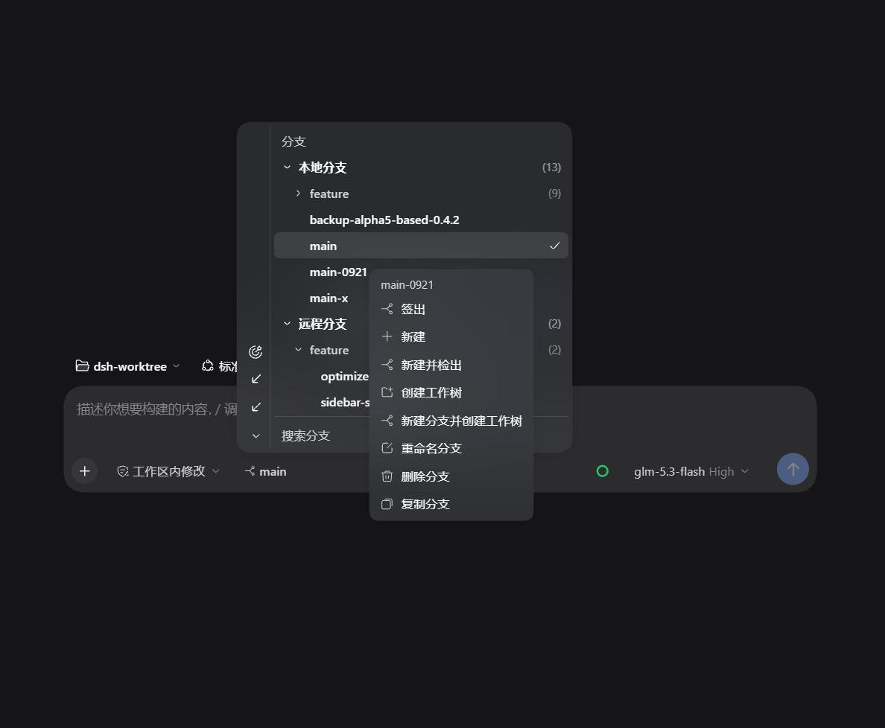

<div align="center">


# dsh-git-worktree

**面向 [DeepSeek Harness (dsh)][dsh] 的 IDEA 风格分支管理、提交图谱、实时 Git 操作与 Worktree 隔离插件。**

<p>
  <a href="https://awesome-dsh-plugin.com"></a>
  <a href="https://www.npmjs.com/package/@laoyuehanni/dsh-git-worktree"></a>
  <a href="https://www.npmjs.com/package/@laoyuehanni/dsh-git-worktree"></a>
  <a href="https://github.com/deepseek-ai/deepseek-harness">= 0.2.0-rc.1" height="20" /></a>
  <a href="./LICENSE"></a>
</p>

**简体中文** · [English](./README.md)

[快速安装](#安装) · [核心功能](#核心功能) · [Worktree 隔离与管理](#4-worktree-隔离删除与跨仓库管理) · [本地开发](#开发)

</div>

<p align="center">
  
</p>

---

## 核心亮点

| 能力 | 一句话说明 |
| --- | --- |
| **IDEA 风格分支树** | 按 `/` 折叠目录、本地/远程分组、实时搜索与定位当前分支，支持彩色 `↗N` / `↙N` / `↗` / `!` 上游状态标记。 |
| **原位提交图谱** | 在分支弹窗内直接展开浏览任意分支的真实提交历史与合并图谱，无需切换检出。 |
| **一键 Worktree 隔离** | 将会话隔离到 `<repo>/.dsh/gitworktree/<分支>/` 并注册为真实工作区，保持主仓库 `git status` 干净。 |
| **安全推送与后台进度** | 独立推送预览窗（支持 Tag 与 `force-with-lease`）、严格快进更新，以及不挡页面的悬浮实时进度卡。 |
| **跨仓库工作树管理** | 在 **设置 → 插件** 中统一管理各仓库内与历史集中存放的 worktree，删除前风险提示并安全归档会话。 |

---

## 安装

需要 `web` profile（`dsh web`）以及 **dsh `0.2.0-rc.1`** 或更新宿主。

```sh
dsh plugin --profile web add @laoyuehanni/dsh-git-worktree
```

> [!TIP]
> 包已声明 `dsh.bundle`，执行 `add` 会自动把插件挂进 profile 层栈，无需手动修改配置。

**更新与移除**

```sh
# 更新插件
dsh plugin --profile web update @laoyuehanni/dsh-git-worktree

# 移除插件（两处位置的 worktree 目录会保留，插件设置存于 dsh 设置文档）
dsh plugin --profile web remove @laoyuehanni/dsh-git-worktree
```

<details>
<summary>使用 dsh <code>0.1.2 alpha</code> 宿主，或从旧版 <code>github:</code> 直装（≤ 0.3.2）升级？</summary>

**运行 dsh `0.1.2 alpha` 宿主**请安装专用兼容通道（当前解析到 `0.4.3-dsh-0.1.2-alpha.5`，peer 锁定 alpha 线，普通 `update` 不会混装）：

```sh
dsh plugin --profile web add @laoyuehanni/dsh-git-worktree@dsh-alpha
```

**从旧版 `github:` 直装（≤ 0.3.2，包名 `dsh-git-worktree`）升级？** GitHub 直装已终止，原地 `update` 会加载失败，请先移除旧包名再从 npm 重新安装：

```sh
dsh plugin --profile web remove dsh-git-worktree
dsh plugin --profile web add @laoyuehanni/dsh-git-worktree
```

已有 worktree 目录与插件设置会完整保留。

</details>

---

## 核心功能

### 1. IDEA 风格分支选择器 & 提交图谱

- **树形目录结构**：把 `/` 视为可折叠文件夹并以末段为标签，打开时自动展开并居中定位当前分支。本地与远程分支分为两组（单远程自动剥离前缀）。
- **搜索与上游标记**：底部搜索保留匹配分支的祖先目录并高亮命中；左侧工具栏提供定位当前分支及全部展开/折叠。本地与工作树行用绿色 `↗N` / 蓝色 `↙N` 表示领先与落后，无上游显示绿色 `↗`（无远程时不显示），上游失效显示 `!`。
- **原位提交图谱**：点击分支菜单左侧图谱按钮即可原位扩大浮层，左侧浏览分支、右侧查看真实提交与合并关系，全程不检出分支。选中提交可查看作者、时间、完整正文（默认三行缩略，可展开内部滚动）与文件摘要。

<details>
<summary>展开详情：提交图谱分页、搜索与作者缓存</summary>

- 列表滚到底部自动加载下一页（同时保留「加载更多」按钮），支持按已加载提交的标题或哈希搜索。
- 作者下拉列出该分支的全部作者并缓存于内存；分支更新、抓取或刷新后自动失效。

</details>

---

### 2. 分支操作 & 行级右键菜单

- **免确认切分支与远程检出**：点击本地分支直接原地 `git switch`；在远程组点击 `origin/feat-x` 直接原地检出并自动建立跟踪分支（勾选工作树开关则隔离进独立 worktree）。在 worktree 会话内其他分支置灰并提示去主仓库操作；已启动会话的菜单只显示当前分支（提取与更新仍可用）。
- **行级右键菜单（键盘支持方向键 + Enter）**：分支行提供「签出 / 新建 / 新建并检出 / 重命名（本地）/ 删除（本地，安全 `-d`，拒绝未合并或被占用分支）/ 复制分支」六个动作；工作树行提供「跳到此工作树 / 复制路径 / 删除工作树」。
- **就地弹窗与连续操作**：新建、重命名、确认等二级弹窗直接在菜单位置展开，边输边校验 git ref 规则与重名；原地动作完成后菜单保持打开可连续操作，失败时保留弹窗便于改名重试。

---

### 3. 远程同步、快进更新、分支推送 & 实时进度

- **远程同步**：工具栏末位刷新按钮一键 fetch 全部远程并清理失效跟踪分支，列表原地刷新，无需切去终端。
- **快进更新当前分支**：工具栏或当前行右键可将当前分支快进到上游；本地分叉、无上游或工作区改动冲突时直接拒绝并给出 git 原话——插件绝不代你 stash 或改写历史。
- **分支推送预览窗**：本地与工作树行右键「推送」打开独立预览窗，先展示本地待推送提交（独立滚动于固定底栏之上）并在后台校验远端，无需切换检出或提交工作区文件。支持推送 Git 标记（所有 / 跟随提交），下拉「强制推送」采用 `force-with-lease` 防止覆盖新提交。
- **悬浮实时进度卡片**：提取、更新、推送期间显示类似 IDEA 后台任务的悬浮卡片，展示远程、git 原始阶段/计数/速度及右上角 `×` 取消按钮。不挡页面、切换会话仍在，长传输不再被 20s / 120s 超时误杀（仅 5 分钟无输出才终止）。

<details>
<summary>展开详情：推送弹窗交互与并发规则</summary>

- **远程与目标编辑**：仅在存在多个远程时显示远程下拉；目标分支按 `Enter` 应用，编辑浮层仅通过 `Enter`、`Esc` 或 `×` 关闭（点击别处不会误关编辑框或推送窗口）。
- **失败自动回弹**：点击「推送」后窗口关闭、进度卡接管；若失败则自动带回错误原因（远端已前进、lease 过期、受保护分支、认证失败）及上次选择的远程/目标/标记，并重新读取目的地供重试。
- **同目录串行保护**：同一目录的其它 git 动作会等待当前传输完成；更新末尾的快进一步开始后不可再取消。

</details>

---

### 4. Worktree 隔离、删除与跨仓库管理

- **Worktree 隔离**：未开始的会话中，右键任意分支即可**「创建工作树」**或**「新建分支并创建工作树」**，隔离至 `<repo>/.dsh/gitworktree/<分支>/`（通过 `.git/info/exclude` 本地忽略，源仓库 `git status` 保持干净）并注册为真实工作区；重复创建同一分支自动复用已有 worktree。会话启动后目录锁定，工作树选项自动隐藏。
- **工作树快捷入口**：主仓库空白会话把被 worktree 占用的分支归入**「工作树」**分组（hover 显示路径），右键「跳到此工作树」直接进入对应目录开启新会话。
- **安全删除工作树**：在「工作树」分组右键或管理弹窗中操作（有运行中会话时禁用）。确认弹窗会用红色标出未提交文件数、领先提交数，并提示对应工作区会话将归档；确认后先删 git worktree（分支保留），仅在 git 成功后才归档会话并注销工作区，失败则 DSH 侧零变更且支持原地重试。
- **工作树管理 & 历史位置只读**：在 **设置 → 插件** 中打开管理弹窗，跨仓库列出各仓库 `.dsh/gitworktree` 与只读历史集中根（默认 `~/.dsh/gitworktree`，旧版 `settings.json` 自动迁入）下的全部工作树（含孤儿目录），按仓库分组并带来源标识。

> [!NOTE]
> - **不影响原生侧边栏**：工作树即普通注册工作区，工作区树会自动把各仓库内的新建工作树归到对应仓库之下（旧的集中存放工作树保持原位）。
> - **`git clean -xdff`（双 `-f`）** 会删掉仓库内的工作树目录（单 `-f` 会跳过嵌套仓库）；删后可通过 `git worktree prune` 恢复注册，但其中未提交的改动会丢失。
> - 某仓库的工作区全部注销后，其工作树不再出现在管理弹窗与自动清理中；重新注册该仓库任一目录即可找回。

---

## 开发

```sh
pnpm install
pnpm build:all
pnpm test                # vitest
node scripts/smoke.mjs   # 基于构建产物的真实 git 冒烟
dsh plugin --profile web add link:D:/Code/dsh-worktree
```

重新构建并重启 `dsh web` 即可生效，客户端开发可在插件目录运行 `pnpm watch:client` 热重载。刻意不设 `prepare` 脚本——`lib/` 不入库，`pnpm publish` 时现场构建打进 tarball。

<details>
<summary>临时只挂 host 半边（仅当次启动生效，不动 profile）</summary>

在仓库旁创建 `cordis.yml` 指向构建出的 host 入口（Windows 需要 `file:///` 形式）：

```yml
- insert:
    - id: git-worktree
      name: 'file:///D:/Code/dsh-worktree/lib/index.js'
```

然后随补丁启动：

```sh
dsh web --patch <插件目录>/cordis.yml
```

此模式仅挂载 host 半边（`/plugin/git-worktree/*` 路由照常工作）；开发 UI 请使用上面的 `link:` 安装方式。

</details>

---

[dsh]: https://github.com/deepseek-ai/deepseek-harness
